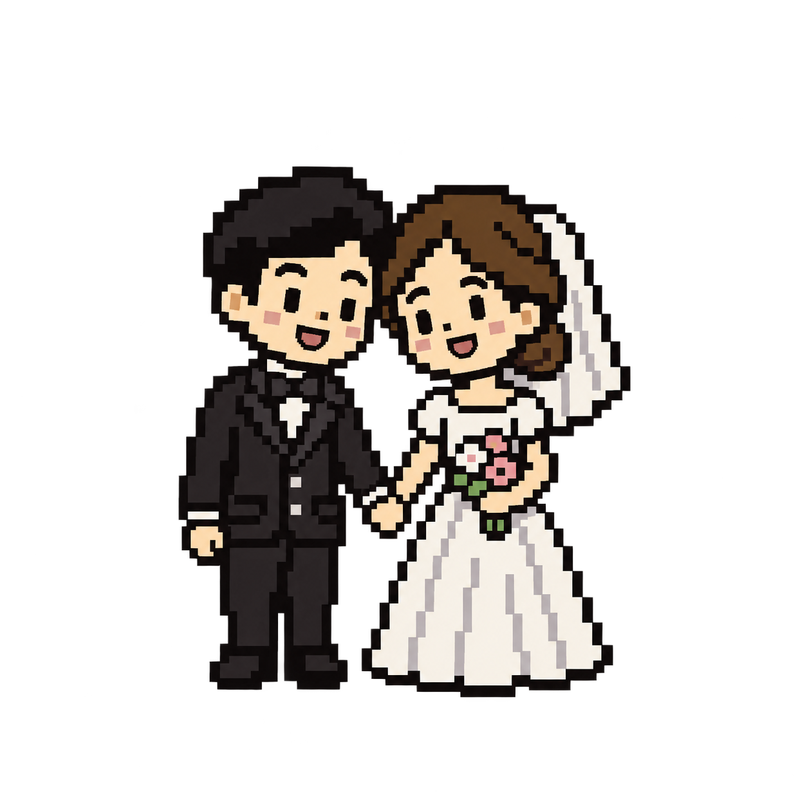

# once-upon-a-valley

[초대 링크 준비](https://loop-by.github.io/once-upon-a-valley/preview.html)에서 신랑·신부 이름과 예식 정보를 입력하고, 완성된 링크를 열어 확인한 뒤 복사하세요. 주소와 점심 안내는 확인된 내용만 입력하세요.

## Google Forms 답장 접수

한 페이지의 공개 Google 설문지에 이름(단답), 법원 예식 참석 여부와 점심 참석 여부(각각 객관식), 축하 메시지(선택, 장문)를 준비합니다. 이 네 가지 외에 필수 질문이나 로그인 요건이 있으면 Google에서 추가 입력을 요구할 수 있습니다.

설문지의 미리 채워진 링크에서 공개 응답 주소와 각 질문의 `entry.숫자`를 확인하고 `rsvp.js`의 `weddingForm`에 입력합니다. `choices`의 값은 해당 질문의 실제 선택지 문구와 일치해야 합니다. 링크와 네 문항이 설정되면 답장 쓰기가 열립니다.

마지막 봉인 버튼은 청첩장 안에서 Google Forms로 직접 POST합니다. 브라우저는 Google의 응답 내용을 읽을 수 없어 저장 여부는 설문지의 응답 탭에서 확인합니다. 네트워크 오류가 발생하면 작성한 내용을 유지합니다.

## 신랑·신부 포즈 참고

